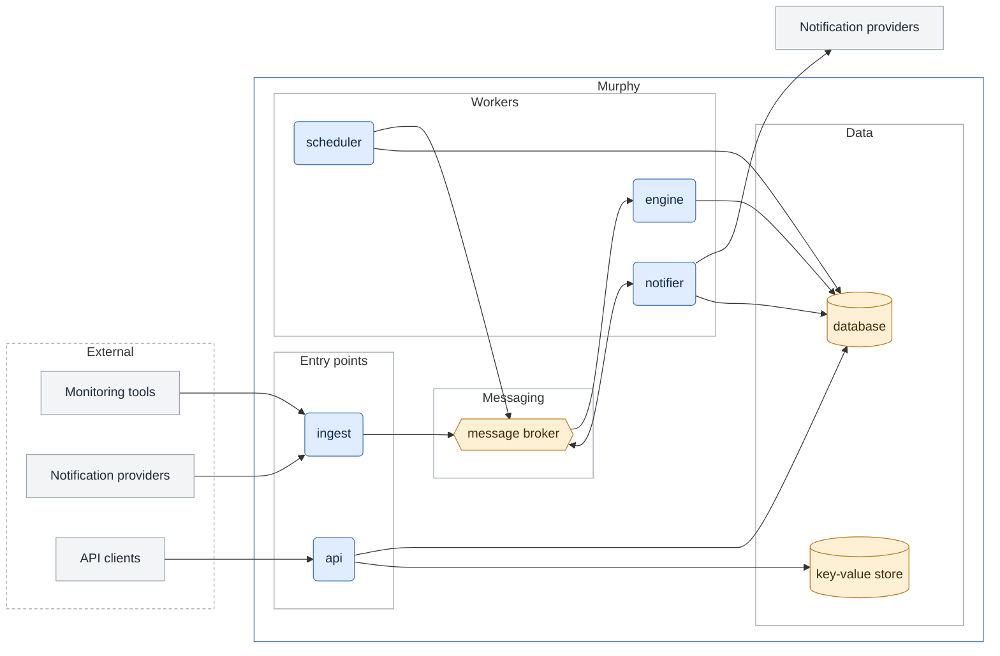
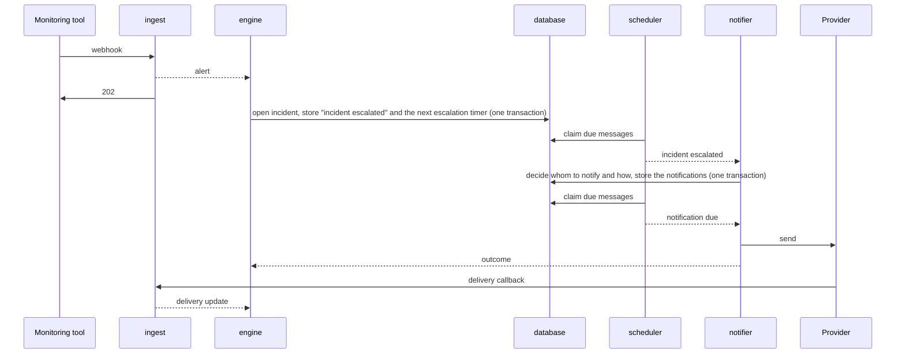
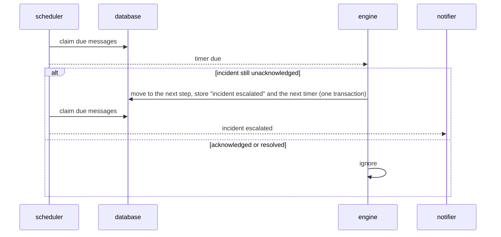
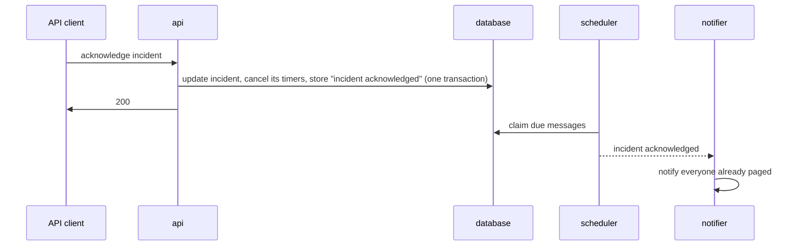
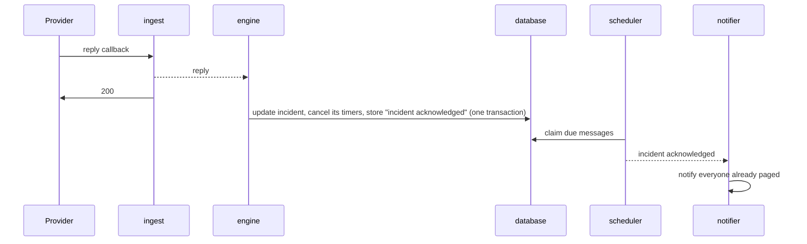

# Architecture overview

Murphy is a set of small components that talk through a message broker and keep their state in databases.

This overview describes the components, what each depends on, how they communicate, and the guarantees that follow. It changes only when one of those changes. Features, rules, event names and payloads belong in the specs and the code.

## Components

### Ingest

The public entry point for webhooks. Monitoring tools send it alerts, and notification providers send it delivery updates and replies. It checks who is calling, turns each payload into a message, and answers only once the message is published, so an accepted webhook is never lost. It doesn't use the database, which keeps intake working when the rest of Murphy is slow or down.

### API

The management API, described by an OpenAPI spec and used by people and automation. It reads and writes the database directly, and changes that belong together happen in one transaction, together with the messages they cause.

### Engine

Decides what happens to incidents, and only ever reacts to messages. It stores each change together with the messages it causes, and handles every message exactly once, even when the broker delivers it twice. It makes no calls outside Murphy.

### Scheduler

Publishes stored messages. Every message that decides whether someone is paged is saved in the database in the same transaction as the change that caused it, and `scheduler` publishes it when it is due, then deletes it once the broker confirms. A crash or a broker outage delays a message and loses none. Escalation timers are stored messages too, so they survive restarts and can be due any time in the future.

### Notifier

Reaches people outside Murphy. It decides whom to notify and how, and sends through providers: webhooks, email, chat, SMS and voice. Its work waits on receivers that can be slow or down, so it runs apart from `engine`, and a failing receiver delays notifications without delaying incidents. Sending doesn't use the database, so notifications already handed to the broker still go out when the database is unavailable. Webhooks are signed with a private key that only `notifier` holds, and receivers check them with the public key `api` serves.

### Migrate

Applies database schema changes. It runs once before the other components start, so several copies of a component never race to change the schema.

## Infrastructure

Murphy depends on what it needs from a message broker, a database and a key-value store, never on a specific product. Each product is an implementation chosen by configuration, and every implementation passes the same test suite against the real service. Supporting another product means adding an implementation that passes it, without touching the components.

The message broker keeps every message until it is processed, delivers it at least once, and hands each message to every component subscribed to its event type. It promises no order, and never has to delay a message, because timers live in the database. Its topics and subscriptions are created outside Murphy, like the databases, and labelled with a topology version; a component refuses to start on a topology older than its release needs. The implementations are SNS with SQS, and NATS JetStream.

A key-value store keeps the `Idempotency-Key` of every request that creates something, with its response, for 24 hours, so `api` answers a retry without doing the work twice. The implementation is Redis.

The database provides transactions, so changes that belong together are applied together, and row locking, so two `scheduler` instances never publish the same message. The implementations are PostgreSQL and MySQL.

## Flows

Dashed arrows are messages through the broker; solid arrows are direct calls.

### From alert to page

`scheduler` deletes each message once the broker confirms it.

### Escalation

### Acknowledgement through the API

### Acknowledgement from a notification

