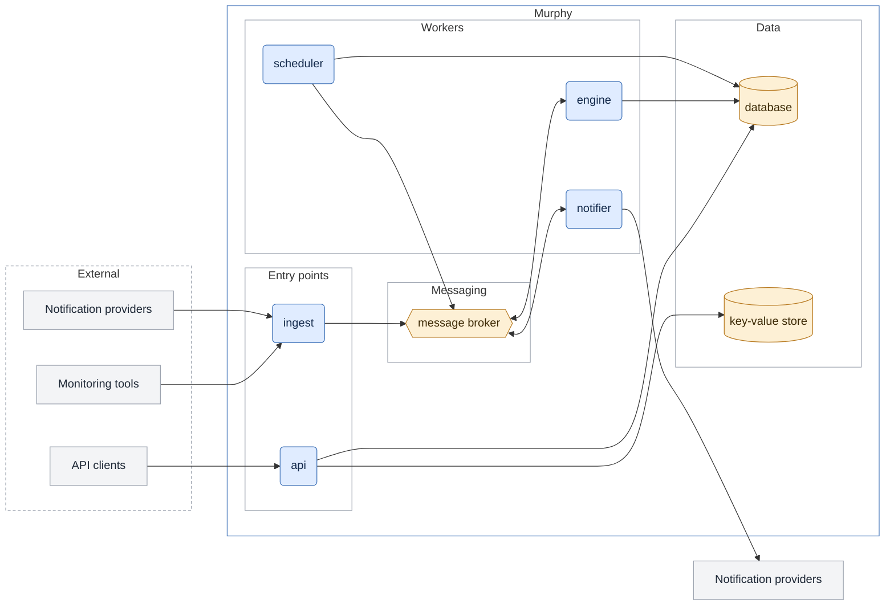
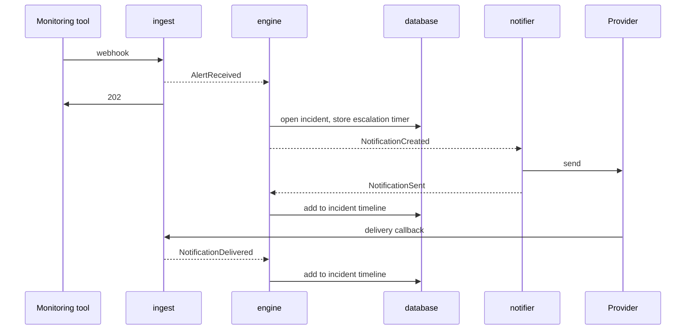
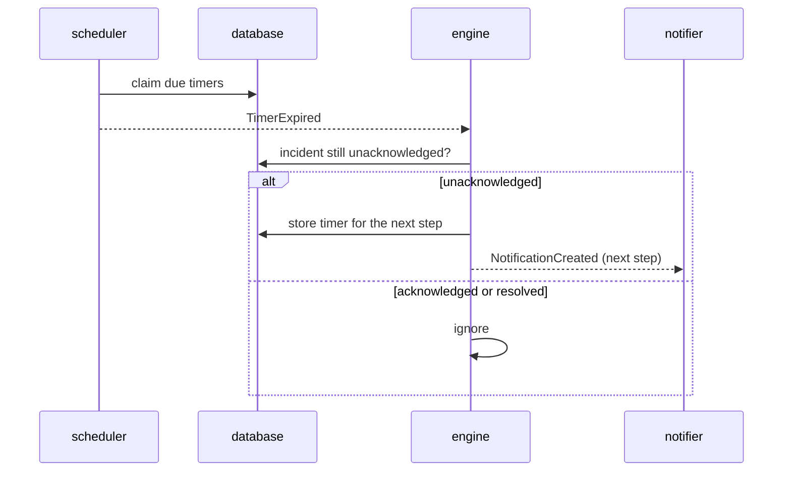
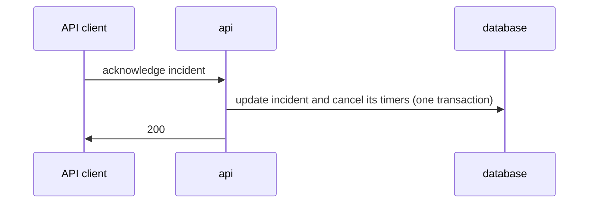
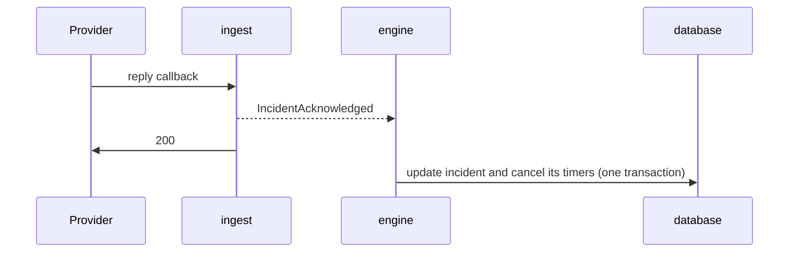

# Architecture overview

Murphy is a set of small components that talk through a message broker and keep their state in databases.

## Components

### Ingest

The public entry point for webhooks. Monitoring tools such as Alertmanager, Grafana and Datadog send it alerts, and notification providers send it delivery updates and replies, like an SMS answer or a button pressed in a chat. It checks who is calling, turns each payload into a message (`AlertReceived`, `NotificationDelivered` or `IncidentAcknowledged`), and answers only once the message is published, so an accepted webhook is never lost. It doesn't use the database, which keeps intake working when the rest of Murphy is slow or down.

### API

The management API, described by an OpenAPI spec and used by people and automation. It reads and writes the database directly: schedules, rotations, escalation policies, users, teams and incidents. Changes that belong together happen in one transaction; acknowledging an incident, for example, also cancels its pending escalation timers.

### Engine

Decides what happens to an incident, and only ever reacts to messages. An alert opens or updates an incident, the on-call schedule decides who to page, and `engine` requests the notifications and stores the timer for the next escalation step. It also records delivery results and acknowledgements that come back from notification providers. It is the only component that changes incident state in response to messages, and it handles every message exactly once, even when the broker delivers it twice.

### Scheduler

Turns time into messages. Escalation timers are rows in the database, so they survive restarts and can be set any time in the future. When a timer is due, `scheduler` publishes `TimerExpired`, and `engine` decides what it means.

### Notifier

Sends notifications through providers: webhooks, email, chat, SMS and voice. It publishes the outcome of every attempt as `NotificationSent` or `NotificationFailed`, and the provider's later delivery update arrives through `ingest`. It only makes outbound calls and doesn't use the database, so notifications that are already queued still go out when the database is unavailable.

### Migrate

Applies database schema changes. It runs once before the other components start, so several copies of a component never race to change the schema.

## Infrastructure

Murphy depends on what it needs from a message broker, a database and a key-value store, never on a specific product. Each product is an implementation chosen by configuration, and every implementation passes the same test suite against the real service. Supporting another product means adding an implementation that passes it, without touching the components.

The message broker keeps every message until it is processed, delivers it at least once, and hands each message to every component that reads its entity. It promises no order: the incident's state machine decides what a late message means. It never has to delay a message, because timers live in the database. Its topics and subscriptions are created outside Murphy, like the databases, and each component checks at startup that its subscription matches the events it handles. The implementations are SNS with SQS, and NATS JetStream.

A key-value store keeps the `Idempotency-Key` of every request that creates something, with its response, for 24 hours, so `api` answers a retry without doing the work twice. The implementation is Redis.

The database provides transactions, so changes that belong together are applied together, and row locking, so two `scheduler` instances never claim the same timer. The implementation is PostgreSQL.

## Flows

Dashed arrows are messages through the broker; solid arrows are direct calls.

### From alert to page

### Escalation

### Acknowledgement through the API

### Acknowledgement from a notification

