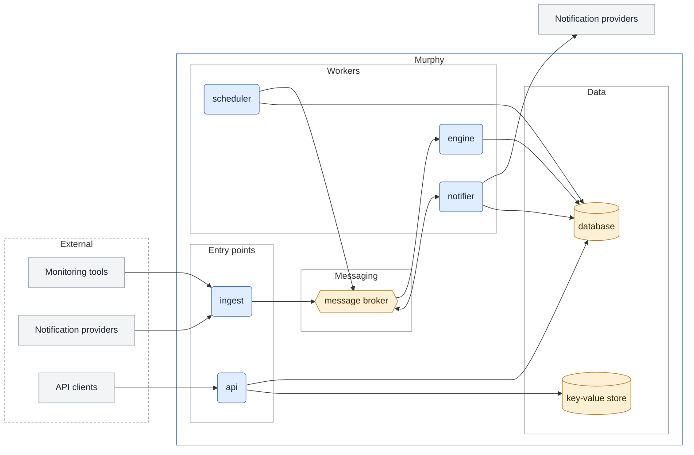
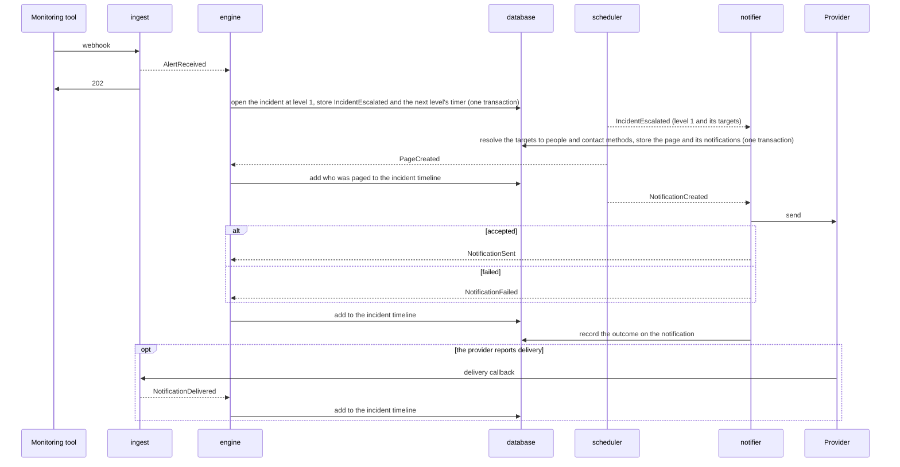
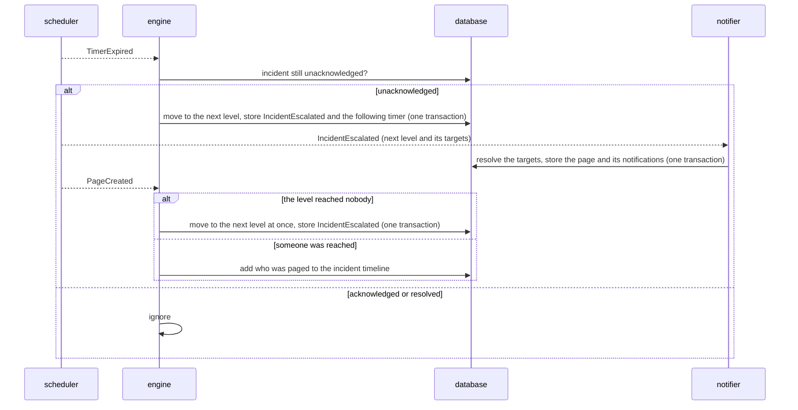
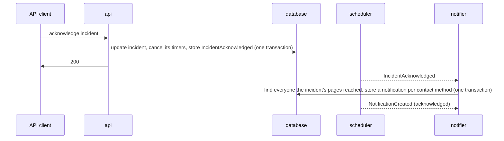
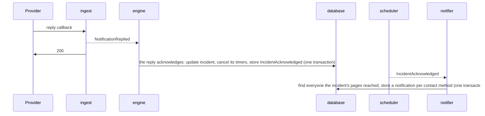

# Architecture overview

Murphy is a set of small components that talk through a message broker and keep their state in databases.

## Components

### Ingest

The public entry point for webhooks. Monitoring tools such as Alertmanager, Grafana and Datadog send it alerts, and notification providers send it delivery updates and replies, like an SMS answer or a button pressed in a chat. It checks who is calling, turns each payload into a message (`AlertReceived`, `NotificationDelivered` or `NotificationReplied`), and answers only once the message is published, so an accepted webhook is never lost. It doesn't use the database, which keeps intake working when the rest of Murphy is slow or down.

### API

The management API, described by an OpenAPI spec and used by people and automation. It reads and writes the database directly: schedules, rotations, escalation policies, users, teams and incidents. Changes that belong together happen in one transaction; acknowledging an incident, for example, also cancels its pending escalation timers and stores the messages it causes.

### Engine

Decides what happens when a message arrives, and stores each change together with the messages it causes. It handles every message exactly once, even when the broker delivers it twice. It makes no calls outside Murphy, so its work depends only on Murphy's database and broker.

### Scheduler

Turns stored messages into published ones. Every message that decides whether someone is paged is saved as a scheduled message in the database, in the same transaction as the change that caused it. `scheduler` publishes each one when it is due, timers at their time and everything else right away, and deletes it once the broker confirms. A change and its messages are therefore never separated: a crash or a broker outage delays a message, and loses none.

### Notifier

Reaches everything outside Murphy: it works out whom to notify and how, and sends through providers (webhooks, email, chat, SMS and voice). Its work waits on receivers and providers that can be slow or down, so it runs apart from `engine`, and a failing receiver delays notifications without delaying incidents. It is also the only component that needs outbound network access.

Each external call is a step of its own that doesn't use the database: `notifier` makes the call and publishes its outcome as a message. Calls already handed to the broker therefore still go out when the database is unavailable.

Webhooks follow [Standard Webhooks](https://www.standardwebhooks.com) and are described by [`openapi/webhooks/v1.yaml`](../openapi/webhooks/v1.yaml). `notifier` signs each one with Murphy's Ed25519 private key, which is part of its configuration and never leaves it. Receivers check the signature with the public key the API serves, and hold no secret of their own. While the key is being replaced, `notifier` signs with both the old and the new key, so receivers switch at their own pace.

### Migrate

Applies database schema changes. It runs once before the other components start, so several copies of a component never race to change the schema.

## Infrastructure

Murphy depends on what it needs from a message broker, a database and a key-value store, never on a specific product. Each product is an implementation chosen by configuration, and every implementation passes the same test suite against the real service. Supporting another product means adding an implementation that passes it, without touching the components.

The message broker keeps every message until it is processed, delivers it at least once, and hands each message to every component subscribed to its event type, such as `murphy.v1.alert.received`; a component never receives event types it has no use for. It promises no order: the incident's state machine decides what a late message means. It never has to delay a message, because timers live in the database. Its topics and subscriptions are created outside Murphy, like the databases, and labelled with a topology version. Each component is given its exact topic and queue, and refuses to start on a topology older than its release needs. The implementations are SNS with SQS, and NATS JetStream.

A key-value store keeps the `Idempotency-Key` of every request that creates something, with its response, for 24 hours, so `api` answers a retry without doing the work twice. The implementation is Redis.

The database provides transactions, so changes that belong together are applied together, and row locking, so two `scheduler` instances never claim the same scheduled message. The implementations are PostgreSQL and MySQL.

## Flows

Dashed arrows are messages through the broker; solid arrows are direct calls.

### From alert to page

`scheduler` publishes every message stored in the database, and deletes it once the broker confirms; the diagrams show that as a single arrow from `scheduler`.

### Escalation

### Acknowledgement through the API

Resolving an incident works the same way, with `IncidentResolved`.

### Acknowledgement from a notification

